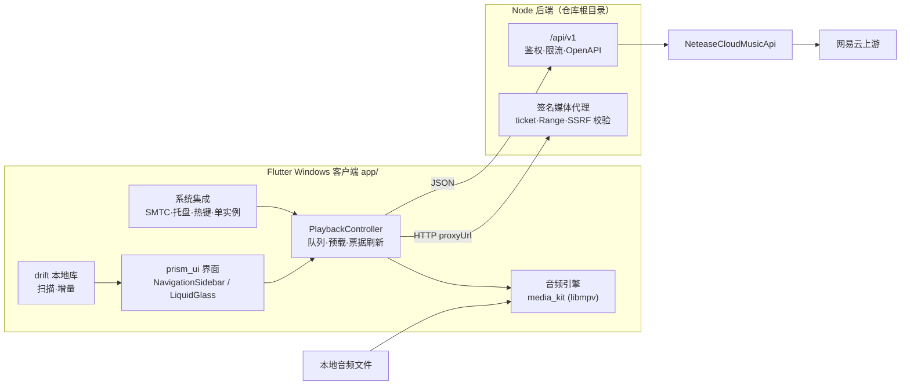

# PLAN.md — Sonora 开发计划

> 定位、版本与开发规范见 [AGENTS.md](AGENTS.md)。本文件是唯一排期来源；里程碑状态变化就地更新。
> 参考产品：[Salt Player for Windows](https://store.steampowered.com/app/3009140/Salt_Player/)。只参考信息架构与交互，不复制资源与代码。

## 1. 一句话

在 Windows 上把「本地无损曲库」与「网易云在线音源」合成一个播放器：界面与手感对标 Salt Player for Windows，UI 全部基于 prism_ui；后端音源能力已具备，客户端从零开始。

## 2. 现状（2026-11-07）

| 部分 | 状态 |
| --- | --- |
| 后端 | 可用：`/api/v1` 38 条路由，46 项测试通过；单账号凭据、票据媒体代理、质量回退、OpenAPI |
| 客户端 | M0 骨架已建：`app/` Flutter 3.47.9 + prism_ui 0.1.2，外壳渲染通过（`flutter analyze` 无问题，2 项 widget 测试通过）；尚未安装 Visual Studio C++ 工具链，`flutter run` / `flutter build windows` 待解锁 |
| 仓库 | `junglecola001/sonora`，public，前后端同仓 |
| 环境 | Windows 11 ARM64 主机；Node 24.19、Flutter 3.47.9（ARM64 内核快照）可用；Visual Studio C++ 待装 |

## 3. 范围

**做**：单窗口桌面播放器；本地文件与网易云在线曲目混合队列；本地增量曲库；逐字歌词与桌面歌词；WASAPI 独占与无间隙；SMTC、托盘、全局热键；主题与动效；中文首发。

**不做**：会员/版权绕过、多账号与多用户、云同步、Steam 工坊、移动端、macOS/Linux 验收、在线音频离线下载（待定）、智能曲风算法（待定）。

## 4. 功能矩阵（Salt Player → Sonora）

| 能力 | Salt Player 参考 | Sonora 做法 | 后端现状 |
| --- | --- | --- | --- |
| 曲库分类 | 歌曲/曲风/专辑/艺术家/文件夹 + 自建歌单 | 同结构，另加在线搜索结果与网易云歌单 | 在线部分已具备 |
| 本地管理 | 增量式，只增不删 | 扫描只增不删，文件缺失标 `missing` | 客户端 |
| 播放引擎 | DirectSound / WASAPI 独占、无间隙、浮点 DSP | libmpv + 独占开关 + 队列预载，M1 定稿 | 客户端 |
| 歌词 | LRC/内嵌、滚动、卡拉 OK、桌面歌词 | 后端已给 `wordByWord`/`lines`/翻译/罗马音，客户端渲染 + 独立桌面歌词窗口 | 已具备 |
| 在线音源 | 无 | 搜索/歌单/专辑/歌手/每日推荐/喜欢/收藏，`proxyUrl` 流播放 | 已具备 |
| 系统集成 | SMTC、媒体键 | SMTC + 媒体键 + 托盘 + 全局热键 + 单实例 + 文件关联 | 客户端 |
| 主题 | 主题风格、自定义字体、多层模糊 | prism_ui 四种 ColorStyle + 字体 + ≤2 层模糊 | 客户端 |
| 音频设置 | 电平表、独占、抖动、dB 音量 | 设备/独占/抖动/音量/可选电平表 | 客户端 |
| 工坊、自定义数据、智能曲风 | 有/规划中 | 不做 | — |

## 5. 架构



关键决策：

- **双进程**：客户端可拉起后端（探测端口 → spawn → 轮询 `/health`），也可连接已在运行的后端；设置页切换。后端默认 `127.0.0.1:3000`，桌面客户端不发送 `Origin`，无需配置 CORS。
- **在线音频不落盘**，走 `proxyUrl`（票据 300s）；本地文件直交引擎。统一 `Track` 模型 + `Source` 枚举，队列可混合。
- **后端不变**：客户端只依赖现有 `/api/v1` 契约；需要新能力时按 AGENTS §5 五件套扩展。

## 6. 界面规格（依据 Salt Player 截图与商店描述）

```text
┌──────────────────────────────────────────────────────────────┐
│ 自绘标题栏：应用名 · 账号 · 效果入口 · 最小化/最大化/关闭        │
├────────────┬─────────────────────────────────────────────────┤
│ 侧栏 240px │ 主区：大标题 + 数量 + 排序/筛选/搜索              │
│ 歌曲       │ ┌ 56px 行：封面 48 · 标题 + 音质徽标 · 艺术家 ·   │
│ 曲风       │ │ 专辑 · 时长 · 当前播放高亮 + 勾选               │
│ 专辑       │ └ …虚拟化列表…                                  │
│ 艺术家     │                                                 │
│ 文件夹     │                                                 │
│ 音乐库     │                                                 │
│ 设置       │                                                 │
│ ─────────  │                                                 │
│ 歌单列表   │                                                 │
│ 我喜欢的   │                                                 │
├────────────┴─────────────────────────────────────────────────┤
│ 播放栏 72px：封面 · 标题/艺术家 · 循环/上一首/播放/下一首/队列 · │
│              更多 · 输出格式/采样率 · 音量 · 静音              │
└──────────────────────────────────────────────────────────────┘
```

播放页：左侧大封面，右侧歌词列（原文/罗马音/翻译，当前行高亮、逐字扫过），背景为封面多层模糊；专辑页为封面 + 标题/艺术家 + 歌曲数/总时长/年份 + 播放/随机按钮 + 光盘分组。

| 区域 | prism_ui 组件 |
| --- | --- |
| 外壳 | `PrismScaffold`、`NavigationSidebar`、`Surface` |
| 列表 | slivers、`ListRow`、`Glyph` 图标 |
| 播放栏 | `LiquidGlass`、`PressRegion` |
| 队列/设置 | `Sheet`、`FormSheet`、`SideSheet` |
| 排序筛选 | `SegmentedControl` |
| 音量/进度 | `Slider` |
| 开关 | `Switch` |
| 弹层 | `Dialog`、`ContextMenu`、`Banner` |
| 空状态 | `NullStatus` |

尺寸与排版：默认 1280×800，最小 960×640；侧栏 272，播放栏 88，列表行高 72（紧凑 64）；标题 28/24，列表主文本 15，次文本 12；圆角走 superellipse；页面转场 250ms；遵循系统「减少动画」。主题默认深色，种子色可选，`vivid`/`tinted`/`soft`/`monochrome` 四风格；字体可替换；模糊层级 ≤2 层以保护性能。参考截图、取色与尺寸测量见 [docs/reference/README.md](docs/reference/README.md)。

## 7. 数据设计

- `Track`：`id`、`source(local|netease)`、`sourceId`、`title`、`artists[]`、`album`、`albumId`、`duration`、`quality`、`artworkKey`、`addedAt`、`missing?`。
- 本地表：`tracks`、`albums`、`artists`、`artist_track`、`genres`、`playlists`、`playlist_items`、`scan_roots`。
- 队列：内存为主，快照落设置目录（切歌时写入，不在每秒进度里写盘）；重启恢复队列与播放位置。
- 设置：JSON 存 app support 目录；Token 走 DPAPI；后端地址可手填。

## 8. 里程碑

依赖顺序：M0 → M1 → M2 →（M3、M4 可并行）→ M5 → M6。M1 风险最高，先做实证再铺 UI。

### M0 工程骨架（0.5–1 天）

状态：**部分完成**。

- [x] Flutter 3.47.9 SDK（本机 ARM64：官方 x64 分发无法跑项目命令，已用 ARM64 Dart 3.13.7 重建 `flutter_tools` 内核快照，见 `app/README.md`）。
- [x] `app/` 脚手架、依赖 pin（prism_ui 0.1.2）、`analysis_options.yaml`、`.gitignore`。
- [x] 深色 `tinted` 主题（种子 `#4CC2FF`）+ 中文字体回退；自绘 Glyph 图标集；标题栏 / 272px 侧栏 / 页面骨架 / 88px 播放栏；空壳可渲染。
- [x] `flutter analyze` 无问题，2 项 widget 测试通过（侧栏导航切换、播放栏占位）。
- [ ] 无边框窗口、拖动区、窗口按钮：`window_manager 0.6` 走 nativeapi 原生资产，测试与构建都需要 MSVC，暂缓到 M5。
- [ ] Visual Studio 2022 C++ 桌面负载：未安装（需管理员），阻塞 `flutter run` / `flutter build windows`。
- [ ] LICENSE：待定（GPL 方案）。

原始 M0 任务（供对照）：

- 安装 Flutter 3.47+ stable 与 VS2022 C++ 桌面负载；`flutter create --platforms=windows --project-name sonora app`。
- 先确认构建架构：本机是 Windows on ARM64。Flutter 3.47 支持 Windows x64/Arm64 目标，但 ARM64 主机上构建 x64 应用有已知问题（[flutter/flutter#186730](https://github.com/flutter/flutter/issues/186730)）。M0 必须实测本机 `flutter run -d windows` 与 `flutter build windows --target-platform windows-arm64`，同时确认插件原生库（libmpv、smtc_windows 的 Rust 库）是否有 Arm64 产物；不可行则改为 x64 构建机或 CI 构建 x64 应用。
- 依赖按 AGENTS §2 pin；`analysis_options.yaml` 收紧；`lib/l10n` 骨架；`window_manager` 无边框窗口 + 自绘标题栏 + 拖动/双击最大化/边缘缩放/尺寸记忆；`NavigationSidebar` 空页面。
- 补 `.gitignore`（Flutter 项）与 LICENSE；冒烟 `smtc_windows` 是否需 Rust 工具链。
- **验收**：`flutter run -d windows` 出空壳；窗口操作正常；`flutter analyze`、`flutter test` 通过；首次提交骨架。

### M1 播放内核实证（最高风险，2–3 天）

- 原型页：选文件 → 播放 → 显示采样率/位深/编码；同接口 A/B `media_kit` 与 `mpv_audio_kit`。
- 矩阵：FLAC（44.1/96/192，16/24bit）、MP3、AAC/M4A、OGG/OPUS、WAV、APE、WV、DSD64/128；外加后端 `proxyUrl` 网络流。
- 指标：切歌间隙、seek 精度、CPU/内存、独占模式采样率跟随、DSD 路径（直通/转 PCM/不支持）。
- 产出 `docs/AUDIO_ENGINE.md`：结论、参数、版本、放弃理由；据此定稿并更新 AGENTS §2。
- **验收**：无间隙测试专辑 0 gap；独占开启后系统混音被接管且采样率显示正确；DSD 结论明确；过期票据/断网可恢复。

### M2 外壳与本地曲库

- 扫描器：后台 isolate、标签与封面提取、`path+size+mtime` 去重、增量规则、进度与取消。
- 页面：歌曲/专辑/艺术家/曲风/文件夹/音乐库；搜索、排序、筛选、多选、右键菜单、队列抽屉。
- 播放栏接线、主题切换、窗口状态记忆、空白与错误状态。
- **验收**：1 万文件冷扫 <60s（SSD）；10 万曲目列表滚动 60fps；重启库与播放位置恢复；文件移动后重扫可重新关联。

### M3 网易云接入

- 设置页：后端地址/Token、`/health` 与 `/capabilities` 探测；Cookie 导入、扫码登录（轮询、过期重来）、登出。
- 搜索、歌单/专辑/歌手详情、每日推荐、私人推荐、播客（按需）；在线播放（quality 选择、`trial` 明确提示）、喜欢/收藏/歌单增删。
- 错误码映射（`LOGIN_REQUIRED`、`TRIAL_ONLY`、`ENTITLEMENT_REQUIRED` 等）、ticket 过期刷新、上游不可用降级页。
- **验收**：未登录可搜可播公开曲；登录后每日推荐与喜欢可用；`trial`/`unavailable` 如实展示；过期票据自动恢复。

### M4 歌词

- 原文/翻译/罗马音、逐字 `wordByWord` 卡拉 OK 高亮、`lines` 回退；偏移 ±5s；字体与配色。
- 桌面歌词独立窗口：置顶、锁定、点击穿透、DPI 缩放、多屏记忆。
- **验收**：抽样 10 首，高亮误差 ≤100ms；100%/150% DPI 清晰；无歌词时降级状态完整。

### M5 系统集成与打磨

- SMTC（封面/标题/进度/按钮）、媒体键、托盘菜单、全局热键、单实例聚焦、音频文件关联。
- 音频设置页：设备、独占、抖动、dB 音量、可选电平表；启动速度优化。
- i18n（中/英）、动效与模糊打磨、无障碍标签与键盘全覆盖。
- **验收**：SMTC 系统浮层可控且信息正确；休眠/锁屏恢复继续播放；二次启动聚焦已有窗口；全键盘可完成播放控制。

### M6 发布

- MSIX 或 Inno Setup（实测二选一）+ 便携 zip；版本号与关于页；崩溃日志落本地。
- GPL-3.0 合规：LICENSE、发布附源码包、NOTICE 汇总。
- **验收**：干净 Win10 与 Win11 VM：安装 → 播放本地 + 在线 → 桌面歌词 → 卸载；无残留。

## 9. 风险与对策

| 风险 | 影响 | 对策 |
| --- | --- | --- |
| prism_ui 处于 0.1.x，API 可能变动 | 高 | 精确 pin 0.1.2；适配集中在 `lib/ui`；升级单独提交并回归页面 |
| GPL-3.0 传染 | 中 | 客户端开源并按 GPL 分发；后端独立进程；发布附源码 |
| WASAPI 独占 / DSD 超出 libmpv 能力 | 高 | M1 实证；不达标则加 native 输出插件（Rust/C++），作为 M2 前置 |
| libmpv 对 APE/WV/DSD 支持不齐 | 中 | M1 矩阵实测；缺格式给明确降级提示，不静默失败 |
| Flutter 桌面生态（SMTC 依赖 Rust、插件兼容） | 中 | M0 冒烟，预留 1 天缓冲 |
| 构建/运行架构（开发机为 Windows on ARM64） | 高 | M0 先验证 Arm64 构建与插件原生库；不行则 x64 构建机/CI，客户端以 x64 模拟运行 |
| 网易云接口变更 / 版权限制 | 中 | 后端已隔离；客户端只依赖 `/api/v1` 契约与错误码 |
| 大曲库性能（10 万曲、封面解码） | 中 | 虚拟化、缩略图 LRU、isolate 解析 |
| 单账号共享（多客户端互相踢账号） | 低 | 设置页说明；不做多账号 |

## 10. 发布验收指标

| 指标 | 目标 | 方法 |
| --- | --- | --- |
| 冷启动到可交互 | <2s（1 万曲库，SSD） | 计时日志 |
| 播放启动 | 本地 <300ms；在线 <1.5s | 计时日志 |
| 无间隙 | 0 gap | 测试专辑听感 + 日志 |
| 采样率切换 | 44.1/48/96/192 正确 | 独占模式 + 设备面板 |
| 歌词同步 | ±100ms | 抽样 10 首人工核对 |
| 列表滚动 | 60fps | DevTools timeline |
| 内存 | <400MB（1 万曲库浏览） | 任务管理器 |
| 空闲 CPU | <1%（暂停） | 任务管理器 |

## 11. 待定决策（需你确认）

1. LICENSE：整仓 GPL-3.0，还是后端 MIT + 客户端 GPL-3.0（prism_ui 强制客户端 GPL）。
2. 音频引擎最终选型与是否接受 native 输出插件（M1 结论驱动）。
3. 发布形态（MSIX / Inno Setup / 便携 zip）与是否要自动更新。
4. 是否做离线下载与本地缓存。
5. 后端默认托管方式：客户端拉起 vs 用户手动启动。
6. 首发语言（中文-only 或中英同步）与默认主题。

## 12. 下一步

1. 安装 Visual Studio 2022 C++ 桌面负载（管理员），解锁 `flutter run -d windows` 与 `flutter build windows`。
2. 首次真机运行空壳，核对窗口尺寸、侧栏宽度、行高与参考图（`docs/reference/`）；补无边框窗口（M5 提前）。
3. M1：用 `media_kit` 播 FLAC/APE，验证 `audio-exclusive`、采样率跟随与 DSD，写 `docs/AUDIO_ENGINE.md`。
